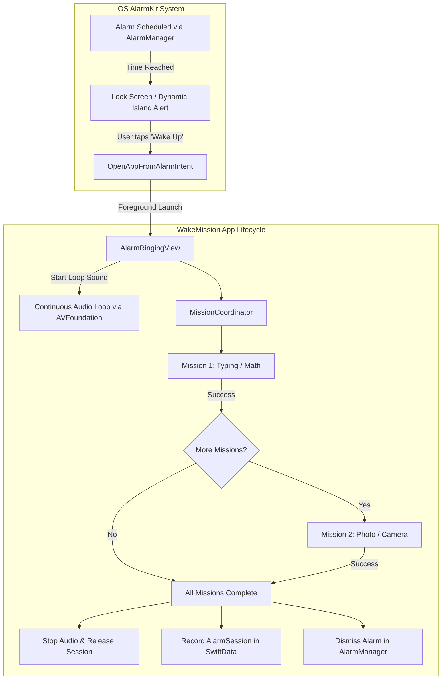

# WakeMission: 6-Week Implementation Plan (MVP to App Store)

## Goal Description
Build and ship **WakeMission 1.0** to the Apple App Store within 6 weeks.
WakeMission is a native iOS wake-up alarm application built around a strict core philosophy: **"An alarm is not just for turning off; to turn it off, you must wake up."**

The product replaces regular snooze/dismiss interactions with sequential **Wake-up Missions**:
1. ⌨️ **Typing Mission**: Type motivational phrases accurately to engage cognitive motor skills.
2. 🧮 **Math Mission**: Solve arithmetic calculations to stimulate mental sharpness.
3. 📷 **Photo Mission**: Walk to a designated target (e.g., bathroom sink) and verify via camera recognition.

Leveraging Apple's native **AlarmKit** and **App Intents**, the application schedules system-level alarms that bypass Silent Mode and Focus filters without relying on fragile background hacks.

---

## User Review Required

> [!IMPORTANT]
> **1. Development Environment & OS Tooling (macOS / Xcode Required)**
> * Current workspace is on Windows (`f:\WORKING\Flutter\alarmspecial`).
> * However, the requested stack—**Swift 6, SwiftUI, SwiftData, AlarmKit, and App Intents**—requires macOS with Xcode (minimum Xcode 16+ supporting iOS 18+ / AlarmKit framework) and a physical iPhone running the compatible iOS version to test system alarms, camera hardware, and device restarts.
> * Please confirm if development/building will occur directly on a Mac or if you are setting up this repository to sync with a macOS workstation or CI/CD environment.

> [!WARNING]
> **2. AlarmKit Interaction & Ringing Flow Mechanics**
> * In iOS, third-party apps cannot force-bring themselves to the foreground from a locked screen without user touch.
> * When an AlarmKit alarm triggers:
>   1. The system displays the Lock Screen / Dynamic Island alert with a prominent action (e.g., *"Wake Up & Start Mission"*).
>   2. Tapping the button executes our custom `AppIntent` (`openAppWhenRun: true`), launching WakeMission into the foreground.
>   3. While the user completes missions, WakeMission takes over audio playback (`AVAudioSession` category `.playback` with `.duckOthers` or continuous loop) to ensure the alarm keeps ringing until all missions pass.
>   4. Once verified, WakeMission calls `AlarmManager.shared.cancel(id:)` or triggers the stop intent and records session statistics.

> [!TIP]
> **3. Photo Mission Verification Strategy: FeaturePrint vs. Object Classification**
> * Rather than only searching for "bathroom sink" via a generic classifier (which often misclassifies in low morning light), we recommend using **`VNGenerateImageFeaturePrintRequest`** (Visual Feature Print comparison):
>   * During setup: User registers a photo of their sink/coffee machine; we store the lightweight feature print.
>   * When alarm rings: User points camera; we compute Euclidean distance against the registered print. If distance < threshold (typically `< 0.45`), mission succeeds.
>   * *Benefit*: Works in any room, adapts to unique home setups, and serves as an instant fallback without training custom models.

---

## Open Questions

> [!NOTE]
> 1. **Alarm Sound Selection for MVP**:
>    Do you want built-in bundled audio files (e.g., 3-5 loud custom alarm sounds like Nuclear Siren, Gentle Chime, Digital Beep) or only Apple's default AlarmKit system sounds? *(Recommendation: Bundle 4 custom loud alarm audio files into the app).*
> 2. **Emergency Fail-safe / Volume Override**:
>    Should there be an emergency shutdown (e.g., 100 power button clicks or 10-minute timeout) to prevent endless ringing if camera/hardware fails, or should volume buttons be kept standard? *(Recommendation: Provide a 10-minute auto-silence backup to prevent runaway battery drain).*

---

## Architecture & System Flow



---

## Proposed Changes

```
WakeMission/
├── App/
│   ├── WakeMissionApp.swift
│   └── AppState.swift
├── Core/
│   ├── Extensions/
│   ├── DesignSystem/ (Colors, Typography, Haptics, AudioPlayer)
│   └── Navigation/
├── Models/
│   ├── AlarmItem.swift
│   ├── MissionItem.swift
│   └── AlarmSessionRecord.swift
├── Services/
│   ├── Alarm/ (AlarmService.swift, AlarmManagerWrapper.swift)
│   ├── Intents/ (OpenAppFromAlarmIntent.swift, StopAlarmIntent.swift)
│   ├── Audio/ (AlarmAudioPlayer.swift)
│   ├── Camera/ (CameraService.swift, FrameExtractor.swift)
│   └── Vision/ (VisionVerificationService.swift, FeaturePrintMatcher.swift)
└── Features/
    ├── AlarmList/ (AlarmListView.swift, AlarmRowView.swift)
    ├── AlarmEditor/ (AlarmEditView.swift, RepeatPicker.swift, MissionSelectorView.swift)
    ├── AlarmRinging/ (AlarmRingingContainerView.swift)
    ├── Missions/
    │   ├── Common/ (MissionHandler.swift, MissionCoordinator.swift)
    │   ├── Typing/ (TypingMissionView.swift, TypingPhraseGenerator.swift)
    │   ├── Math/ (MathMissionView.swift, MathProblemGenerator.swift, KeypadView.swift)
    │   └── Photo/ (PhotoMissionView.swift, ReferenceRegistrationView.swift)
    ├── History/ (StatsView.swift, StreakCalendarView.swift)
    └── Onboarding/ (OnboardingView.swift, PermissionRequestView.swift)
```

---

## 6-Week Detailed Execution Roadmap

### Week 1 — Project Foundation & Reliable AlarmKit Lifecycle
**Goal**: Build a solid project foundation and prove the alarm lifecycle end-to-end on a physical iPhone. No flashy UI yet—reliability is priority #1.

* **Day 1–2: Project Setup & Core Models**
  * Initialize Xcode project targeting iOS 18+, Swift 6 mode, SwiftUI, SwiftData.
  * Define SwiftData `@Model` classes:
    ```swift
    @Model
    final class AlarmItem {
        @Attribute(.unique) var id: UUID
        var time: Date
        var label: String
        var repeatDays: [Int] // 1: Sun .. 7: Sat
        var isEnabled: Bool
        var soundName: String
        var snoozeEnabled: Bool
        @Relationship(deleteRule: .cascade) var missions: [MissionItem]
    }
    ```
  * Define `MissionItem` (type: `.typing`, `.math`, `.photo`, order, difficulty, configPayload).
* **Day 3–4: Milestone 0 Prototype ("Alarm in 1 Minute")**
  * Configure `Info.plist` with `NSAlarmKitUsageDescription`.
  * Implement `AlarmService`:
    * `requestAuthorization() -> Bool`
    * `schedule(alarm: AlarmItem) async throws`
    * `cancel(id: UUID) async throws`
  * Wire `OpenAppFromAlarmIntent: AppIntent` to alarm secondary/action button.
  * **Critical Physical Device Stress Test**:
    * Schedule alarm for T+1 min.
    * Test scenarios: Foreground, background, force-killed app, locked screen, Silent switch ON, Do Not Disturb / Focus ON, reboot device.
* **Day 5–7: Alarm CRUD Interface**
  * Build minimalist `AlarmListView` with toggle switch and time indicator (`"in 7h 42m"`).
  * Build `AlarmEditView`: Wheel time picker, repeat day chips, label input, sound selector.
  * Connect SwiftData `@Query` to list and auto-reschedule via `AlarmService` when toggled.

---

### Week 2 — Mission Engine + Typing & Math Missions
**Goal**: Implement the sequential mission coordination engine and deliver the first two brain-stimulating missions.

* **Day 8–9: Mission Engine Architecture**
  * Define the unified protocol:
    ```swift
    protocol MissionHandler: ObservableObject {
        var isCompleted: Bool { get }
        var progress: Double { get }
        func start() async
        func reset()
    }
    ```
  * Implement `MissionCoordinator`:
    * Manages queue `[MissionItem]` associated with the ringing alarm.
    * Tracks active index, prevents back-navigation, disallows app swipe away until finished.
* **Day 10–11: Typing Mission**
  * Database of 50+ curated motivational wake-up quotes categorized by difficulty:
    * *Easy*: Short (15–20 chars, e.g., *"Trust yourself"*).
    * *Medium*: Medium phrase (30–45 chars).
    * *Hard*: 2 phrases or punctuation heavy.
  * Real-time character validator with green/red cursor feedback and accurate completion trigger.
* **Day 12–14: Math Mission**
  * Procedural math generator:
    * *Easy*: `A + B`, `A - B` (1 to 99).
    * *Medium*: `A * B` (multiplication tables up to 15) and 3-operand additions.
    * *Hard*: Multi-step equations `(A * B) - C`.
  * Custom in-app numeric keypad for rapid one-handed typing without keyboard shift bugs.
  * Consecutive problem tracker (e.g. solve 3 problems correctly to pass).

---

### Week 3 — Camera & Vision Mission (Bathroom / Scene Recognition)
**Goal**: Build the flagship wake-up differentiator—forcing the user out of bed to the bathroom.

* **Day 15–16: AVFoundation Camera Pipeline**
  * Implement lightweight `CameraService` with `AVCaptureSession`:
    * Setup 720p / 1080p back camera video feed.
    * Output frames via `AVCaptureVideoDataOutputSampleBufferDelegate` at throttled 5–10 FPS (to preserve battery and avoid overheating).
  * Build full-screen camera viewfinder overlay with scanning reticle and live feedback text.
* **Day 17–19: Vision & Recognition Engine (Dual-Strategy)**
  * **Strategy A (Primary - Visual FeaturePrint Matching)**:
    * Use Apple's `VNGenerateImageFeaturePrintRequest`.
    * User registers their bathroom sink / kitchen station during daytime.
    * Live camera frames generate feature prints; compare with `VNFeaturePrintObservation.computeDistance`.
    * Threshold `< 0.42` over 3 consecutive frames = SUCCESS.
  * **Strategy B (Zero-setup Fallback - Scene Classification)**:
    * Apple `VNClassifyImageRequest` looking for classes: `washbasin`, `sink`, `bathroom`, `faucet`, `toilet`.
    * Confidence `> 0.70` = SUCCESS.
* **Day 20–21: Checkpoint Evaluation**
  * Validate recognition speed on physical device under low light (typical morning conditions).
  * Ensure seamless fallback to Math/Typing if camera hardware permissions are revoked.

---

### Week 4 — UX/UI Refinement & Anti-Cheat System
**Goal**: Turn working logic into a sleek, premium product that is tamper-resistant.

* **Day 22–24: Design System & Onboarding**
  * High-contrast dark mode design with sleek modern typography (e.g., SF Pro Display / Rounded).
  * 3-step high-converting onboarding flow:
    1. *"Wake up. For real."*
    2. *"Missions require getting out of bed."*
    3. Essential permission requests (AlarmKit + Camera + Notifications) with clear visual explanation.
* **Day 25–26: Mission Setup & Reordering UX**
  * Drag-and-drop mission reordering in `AlarmEditView` using SwiftUI `.onMove`.
  * Clean UI for taking and storing reference photos for the Photo Mission.
* **Day 27–28: Anti-Cheat Safeguards**
  * **Live Stream Only**: Strict prohibition of photo album selection.
  * **Motion & Variance Check**: Verify brightness/motion variance across 10 frames to defeat holding a printed photo or iPad screen in front of the lens.
  * **Volume Lockout**: Prevent hardware volume down buttons from killing the alarm while missions are active.

---

### Week 5 — Statistics, Polish & TestFlight Beta
**Goal**: Data tracking, bug hardening, and external validation with real users.

* **Day 29–31: Statistics & Wake-Up History**
  * Track `AlarmSessionRecord` in SwiftData:
    * `scheduledAt`, `triggeredAt`, `completedAt`, `durationSeconds`, `missionsCompletedCount`, `snoozeCount`.
  * History View:
    * Current wake-up streak (e.g., *"5 Day Streak 🔥"*).
    * Weekly completion chart and average wake-up time.
* **Day 32–33: TestFlight Build Distribution**
  * Deploy internal build to 5–10 testers via TestFlight.
* **Day 34–35: Edge-Case Test Suite Execution**
  * Test matrix:
    * Alarm scheduled across midnight (`23:59` to `00:01`).
    * Timezone / daylight saving shifts.
    * Low battery (< 5%) and Low Power Mode.
    * Incoming phone call while alarm is ringing.
    * Permission rejections handling.

---

### Week 6 — Bug Fixing & App Store Submission
**Goal**: Strict feature freeze, zero crashes, App Store compliance, and submission.

* **Day 36–38: Feature Freeze & Performance Tuning**
  * Memory leak profiling with Xcode Instruments (ensure camera session deallocates immediately).
  * Fix all P0/P1 defects reported by TestFlight testers.
* **Day 39–40: Store Assets & Reviewer Documentation**
  * App Store Icon, 6.7" & 6.1" high-resolution screenshots.
  * Privacy Policy hosted online.
  * Comprehensive App Review Notes:
    * Detail why `NSAlarmKitUsageDescription` and `NSCameraUsageDescription` are essential.
    * Provide reviewer test credentials/demo mode to trigger an alarm in 10 seconds for review convenience.
* **Day 41–42: 🚀 App Store Submission**
  * Upload production binary via Xcode Organizer.
  * Submit for App Review!

---

## Verification Plan

### Automated Tests
* **Unit Tests**:
  * `MathProblemGeneratorTests`: Verify range, difficulty constraints, and division-by-zero protection.
  * `TypingPhraseTests`: Verify character matching, space normalization, and diacritic handling.
  * `FeaturePrintMatcherTests`: Test image comparison distance algorithms with known sample fixtures.
* **Command (on macOS CI / Xcode)**:
  ```bash
  xcodebuild test -scheme WakeMission -destination 'platform=iOS Simulator,name=iPhone 16 Pro'
  ```

### Manual Physical Device Verification Matrix
| Test Case | Procedure | Expected Outcome |
| :--- | :--- | :--- |
| **Bypass Silent Mode** | Enable physical Silent switch, schedule alarm for T+1 min, lock device. | Alarm audio plays at full designated volume. |
| **Bypass Focus Mode** | Turn on Sleep / Do Not Disturb Focus mode. | Alarm banner and sound pierce through Focus. |
| **App Terminated** | Force-kill WakeMission from App Switcher; lock screen. | Alarm rings at scheduled time. |
| **Action Launch** | Tap "Wake Up" button on Lock Screen alert. | WakeMission immediately opens into MissionCoordinator. |
| **Sequential Missions** | Complete Typing -> Complete Math -> Complete Camera. | Each transitions seamlessly; audio stops only on last step. |
| **Anti-Cheat Verification** | Place finger over camera or hold static paper photo. | Verification fails until real target with live motion is shown. |
